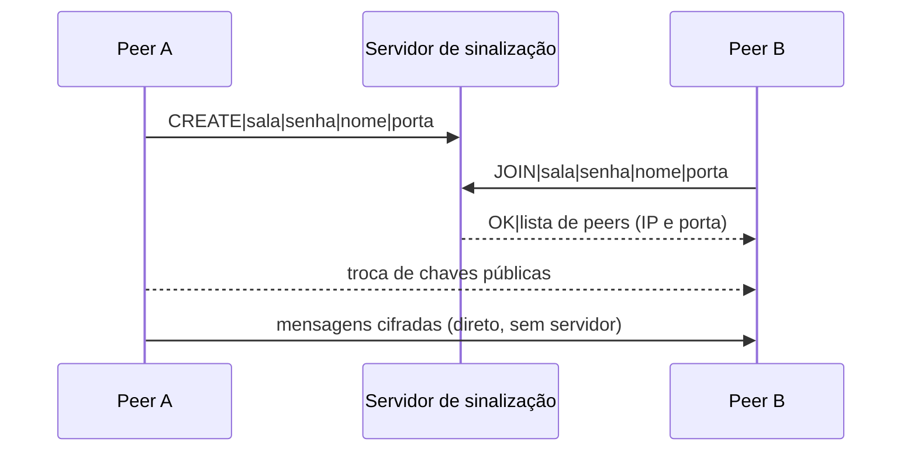

# Chat P2P

Chat **peer-to-peer full-duplex** em Python, feito para a disciplina de Redes de Computadores da UFPB.

Um servidor central só faz a sinalização (lista as salas e apresenta os participantes). Depois disso, as mensagens vão **direto de um peer para o outro**, sem passar pelo servidor.

## Funcionalidades

- **Salas com senha:** criar, listar, entrar e sair
- **Mais de dois usuários** por sala
- **Mensagens criptografadas** de ponta a ponta
- **Interface gráfica** em Tkinter, com lobby, lista de participantes e área de chat
- **UDP hole punching** no cliente de terminal, para conectar peers atrás de NAT

## Como funciona



O protocolo de sinalização é textual e simples (`LIST`, `CREATE`, `JOIN`, `LEAVE`). O servidor usa uma thread por conexão e um `lock` para evitar condições de corrida no registro das salas.

**Criptografia**

- `client.py`: troca de chaves **X25519**, derivação com **HKDF** e cifragem com **AES-GCM**
- `client_gui.py`: chave derivada da senha da sala com **PBKDF2-HMAC-SHA256** (200 mil iterações) e cifragem com **Fernet**

## Arquivos

| Arquivo | Papel |
|---|---|
| `server.py` | Servidor de sinalização (TCP, porta 9005) |
| `client.py` | Cliente de terminal com hole punching UDP e E2E |
| `client_gui.py` | Cliente com interface gráfica |

## Como rodar

```bash
pip install cryptography
python server.py          # em uma máquina acessível pelos peers
python client_gui.py      # em cada participante
```

No `client.py`, troque `SIGNAL_HOST` pelo IP do servidor.

## Próximos passos

- [ ] Proteção contra força bruta na senha das salas
- [ ] Protocolo de aplicação para mensagens mais ricas (estudando XMPP)
- [x] Mais de dois usuários por sala
- [x] Mensagens criptografadas
- [x] Interface gráfica
